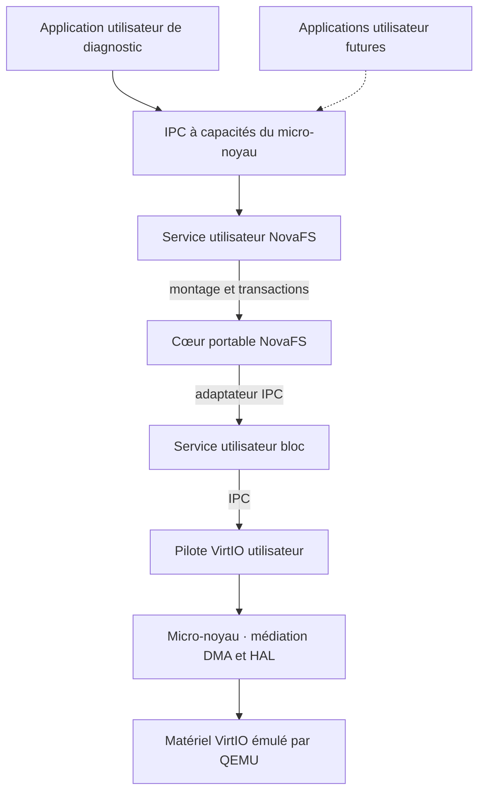

# NovaOS

NovaOS est un système d’exploitation expérimental à micro-noyau, développé principalement en Rust pour x86_64 et AArch64. Le projet explore une question concrète : comment faire coopérer des programmes, des services et des pilotes tout en donnant à chacun le minimum de droits nécessaire ? Son noyau `no_std` et son interface binaire native (ABI) lui permettent de définir ses propres contrats, sans dépendance obligatoire à POSIX.

Dans **NovaOS v0.11.0**, une application peut monter un volume autonome, créer un fichier et en retrouver les octets après redémarrage de QEMU. Le service utilisateur exécute le moteur **NovaFS v0.9.12**, également utilisable sur macOS.

## Philosophie et architecture

Le micro-noyau fournit les espaces mémoire, la préemption et les communications entre processus (IPC). Une capacité désigne un point de communication et les opérations que son détenteur peut y effectuer. Ainsi, une application peut interroger le service NovaFS sans obtenir le droit de programmer le disque. Le pilote en espace utilisateur prépare les requêtes. Un composant de confiance dans le noyau contrôle les descripteurs DMA avant leur publication.

Le noyau commun confie à une couche matérielle propre à chaque architecture les transitions de privilège, les interruptions et la pagination. Les essais sur les deux architectures éprouvent le même contrat utilisateur. Les mesures de latence et de mémoire accompagnent les tests de panne pour guider les choix de performance et de fiabilité.

Le schéma suit le chemin de stockage. Les traits pleins indiquent les échanges actuels et les pointillés les intégrations prévues.



## État du projet

| Domaine | État | Ce que l’on peut utiliser ou suivre |
|---|---|---|
| Démarrage et affichage | Implémenté | UEFI avec Limine, framebuffer et journal série sur les deux architectures. |
| Mémoire et exécution | Implémenté | Mémoire virtuelle protégée, ELF multipages, tas privés, piles gardées, ordonnanceur préemptif mono-CPU et processus isolés en Ring 3 ou EL0. |
| ABI et services | Implémenté | Appels système natifs et IPC à capacités entre processus disposant d’espaces d’adressage distincts. |
| Stockage bloc | Implémenté | Lecture, écriture et synchronisation sur un disque VirtIO optionnel. Le service bloc et le pilote s’exécutent en espace utilisateur. |
| NovaFS | En développement | Le moteur macOS gère transactions CoW, snapshots, clones, compression LZ4, chiffrement et vérification des blocs. NovaOS expose le montage et les transactions sur les fichiers des volumes autonomes. |
| Interface texte | Implémenté | Le prompt de diagnostic du noyau accepte la saisie AZERTY sur x86_64. |
| Environnement utilisateur | Prévu | Shell utilisateur, commandes, applications natives de distribution et gestion des comptes. |
| Interface et distribution | Prévu | NovaUI et système hybride immuable. |

## Compiler et démarrer

Depuis la racine du dépôt, sur un Mac Apple Silicon, utiliser Rust stable avec les cibles `x86_64-unknown-none` et `aarch64-unknown-none-softfloat`, QEMU avec les firmwares EDK II, xorriso et Python 3.

```sh
make -C novaOS ARCH=x86_64 build
make -C novaOS ARCH=aarch64 build
make -C novaOS ARCH=x86_64 run
make -C novaOS ARCH=aarch64 run
```

Les cibles `build` produisent respectivement `novaOS/build/novaos.iso` et `novaOS/build/novaos-aarch64.iso`. Les cibles `run` démarrent QEMU avec affichage et sortie série dans le terminal. Depuis `novaOS/`, omettre `-C novaOS`. [Configuration QEMU et UTM](novaOS/README.md)

## Tester et approfondir

```sh
make -C novaOS ARCH=x86_64 test
make -C novaOS ARCH=aarch64 test
make -C novaOS ARCH=x86_64 file-test
make -C novaOS ARCH=aarch64 file-test
novaFS/lab/run test --offline
```

Les tests NovaOS exercent en VM le démarrage, les changements de privilège et l’ABI. Les cibles `ipc-test` et `block-test` du même Makefile couvrent respectivement les échanges à capacités et le disque virtuel, y compris les erreurs d’E/S et la relecture après redémarrage. [ABI native](novaOS/docs/abi.md) · [Validation IPC](novaOS/docs/mesures-v0.8.0.md) · [Qualification du stockage](novaOS/docs/stockage-bloc-v0.10.0.md)

NovaFS utilise son propre workspace Cargo et des images jetables. Ses bancs macOS couvrent les coupures simulées, la corruption et la récupération. La validation croisée utilise ARM64 natif et x86_64 sous Rosetta. [Tests de coupure](novaFS/docs/novafs-p1-coupures.md) · [Vérification et réparation contrôlée](novaFS/docs/novafs-p8-scrub.md) · [Commandes des campagnes et relevés mémoire historiques](novaOS/docs/validation-reorganisation.md)

## Organisation du dépôt

```text
OS/
├── novaOS/         Micro-noyau, ABI, services, pilotes et bancs QEMU
├── novaFS/         Moteur de fichiers indépendant et laboratoire macOS
├── components/     Emplacement des futures commandes et applications
├── distribution/   Emplacement des futurs manifestes et outils d’assemblage
└── README.md
```

Les deux derniers répertoires sont en construction. Les images de développement se construisent aujourd’hui depuis le workspace NovaOS. [NovaOS](novaOS/README.md) · [NovaFS](novaFS/README.md) · [Composants](components/README.md) · [Distribution](distribution/README.md)

## Feuille de route

La prise en charge native des catalogues de pools et des volumes chiffrés reste ouverte. Les orientations à plus long terme comprennent un shell et des commandes utilisateur, des comptes et permissions, des compilateurs natifs et une interface graphique NovaUI. La compatibilité SwiftUI/AppKit reste exploratoire.

La distribution vise une architecture hybride immuable, avec une base système mise à jour de manière atomique, un retour à la version précédente et des données utilisateur modifiables. Ce modèle reste à développer.

## Contribuer

Pour signaler un problème, indiquer le commit, l’architecture, la commande de reproduction et le résultat observé. Pour proposer une amélioration, décrire le besoin et le composant concerné. Une contribution au code gagne à inclure un test qui exerce le comportement modifié, les résultats sur les cibles concernées et la mise à jour du contrat documenté.

## Licences

NovaOS est distribué sous licence MIT et NovaFS sous Mozilla Public License 2.0. Les avis des dépendances embarquées accompagnent les images NovaOS dans `licenses/`. Chaque autre composant relève de sa licence propre lorsqu’elle est définie. [Licence NovaOS](novaOS/LICENSE) · [Licence NovaFS](novaFS/LICENSE)
