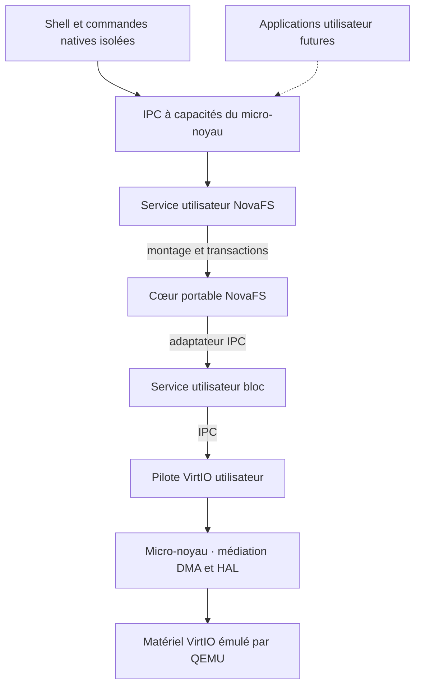

# NovaOS

NovaOS est un système d’exploitation expérimental à micro-noyau, développé principalement en Rust pour x86_64 et AArch64. Le projet explore une question concrète : comment faire coopérer des programmes, des services et des pilotes tout en donnant à chacun le minimum de droits nécessaire ? Son noyau `no_std` et son interface binaire native (ABI) lui permettent de définir ses propres contrats, sans dépendance obligatoire à POSIX.

**Les deux phases Rust de NovaOS v0.20.0 sont intégrées dans `main`.** Le SDK source `nova-system` 0.2.0 permet de compiler sur l’hôte une application Rust `no_std` pour AArch64 et x86_64. L’exemple admis au catalogue crée deux threads, leur attribue des valeurs TLS distinctes, synchronise leur travail avec un mutex et recueille leurs résultats par jonction. [Guide du SDK](novaOS/docs/sdk-rust-v0.20.0.md) · [Qualification sur les deux architectures](novaOS/docs/rust-sdk-phase2-v0.20.0.md)

Le jalon NovaOS v0.20.0 est clos avec la livraison du SDK Rust natif `nova-system` 0.2.0. [Matrice de clôture](novaOS/docs/cloture-rust-v0.20.0.md)

La v0.19.0 a introduit un pilote NVMe isolé en Ring 3 dans le profil expérimental QEMU Q35 x86_64 avec Intel VT-d. Des capacités distinctes autorisent la lecture, l’écriture et la synchronisation d’un namespace virtuel. Le service NovaFS y monte un volume P9 et confirme ses transactions après la seconde barrière. [Qualification NVMe et limites](novaOS/docs/nvme-phase3-v0.19.0.md) · [Fondations matérielles](novaOS/docs/materiel-phase4-v0.18.0.md)

L’archive UTM AArch64 **v0.17.0** installe un volume NovaFS P9 sur disque VirtIO vierge dans UTM 5.0.8 pour AArch64, puis démarre depuis le disque seul. Le shell série `nsh` exécute des scripts UTF-8 avec variables, conditions, boucles et motifs récursifs depuis le terminal. L’éditeur plein écran `vi` gère des textes de taille dynamique, offre plusieurs niveaux d’annulation et de rétablissement, crée des scripts et enregistre les modifications d’un fichier existant sous un nouveau nom. Il est lancé par le shell, qui délègue les copies, déplacements et retraits aux commandes isolées. **NovaFS v0.9.13** fournit aussi la migration explicite des images historiques sur macOS. [Image installable v0.17.0](distribution/images/novaos-0.17.0-utm-aarch64.tar.gz) · [Procédure UTM](novaOS/docs/fusion-smp-v0.17.0.md#installation-dans-utm) · [Éditeur vi](novaOS/docs/vi-v0.16.2.md) · [Scripts nsh](novaOS/docs/nsh-scripts-v0.16.0.md) · [Commandes natives](novaOS/docs/cli-v0.15.1.md) · [Format et compatibilité](novaFS/docs/novafs-p9-timestamps.md)

Le stockage classique et le polling sont actifs par défaut. L’activation des E/S groupées dépend des correctifs expérimentaux de qualification. Les dix profils ont été reconstruits sur les sources v0.18.0. [État de la qualification](novaOS/docs/fusion-materiel-v0.18.0.md) [Journal des versions](CHANGELOG.md) · [Qualification SMP et profil de distribution à un vCPU](novaOS/docs/fusion-smp-v0.17.0.md) · [Mesures du stockage groupé](novaOS/docs/reservations-dma-v0.17.0.md#performance-de-la-sauvegarde-groupée)

La MOA a fixé **NovaOS v0.30.0 comme première version stable serveur généraliste en mode texte**. [Périmètre approuvé et jalons proposés](novaOS/docs/reconciliation-v0300/proposition.md)

## Philosophie et architecture

Le micro-noyau fournit les espaces mémoire, la préemption et les communications entre processus (IPC). Une capacité désigne un point de communication et les opérations que son détenteur peut y effectuer. Ainsi, une application peut interroger le service NovaFS sans obtenir le droit de programmer le disque. Le pilote en espace utilisateur prépare les requêtes. Un composant de confiance dans le noyau contrôle les descripteurs DMA avant leur publication.

Le noyau commun confie à une couche matérielle propre à chaque architecture les transitions de privilège, les interruptions et la pagination. Les essais sur les deux architectures éprouvent le même contrat utilisateur. Les mesures de latence et de mémoire accompagnent les tests de panne pour guider les choix de performance et de fiabilité.

Le schéma suit le chemin de stockage. Les traits pleins indiquent les échanges actuels et les pointillés les intégrations prévues.



## État du projet

| Domaine | État | Ce que l’on peut utiliser ou suivre |
|---|---|---|
| Démarrage et affichage | Implémenté | UEFI avec Limine, framebuffer et journal série sur les deux architectures. |
| Mémoire et exécution | Implémenté | Mémoire virtuelle protégée, ELF multipages, tas privés, piles gardées, ordonnanceur SMP préemptif qualifié sur 1, 2 et 4 vCPU et processus isolés en Ring 3 ou EL0. |
| Applications Rust | SDK 0.2.0 qualifié sur deux ISA | Compilation croisée, admission au catalogue, piles gardées, TLS et collecte unique après transfert du droit de jonction. |
| ABI et services | Implémenté | Appels système natifs et IPC à capacités entre processus disposant d’espaces d’adressage distincts. |
| Stockage bloc | Implémenté | Lecture, écriture et synchronisation sur un disque VirtIO optionnel. Le service bloc et le pilote s’exécutent en espace utilisateur. Le profil NVMe Q35 se sélectionne explicitement. |
| NovaFS | En développement | Le moteur macOS gère transactions CoW, snapshots, clones, compression LZ4, chiffrement et vérification des blocs. NovaOS expose le montage et les transactions sur les fichiers des volumes autonomes. |
| Interface texte | Implémenté | Le prompt de diagnostic du noyau accepte la saisie AZERTY sur x86_64. |
| Environnement utilisateur | Implémenté | Shell série et interpréteur de scripts avec édition UTF-8, historique privé et alias. Commandes isolées, dont `cp`, `mv`, `touch`, `more`, `wc` et `tail`. |
| PCI, MMIO, IRQ et DMA | Profils expérimentaux | Pilote utilisateur EDU sous QEMU et Intel VT-d sur la topologie Q35 qualifiée. |
| Distribution UTM AArch64 v0.17.0 | Qualifiée | Installation GPT et démarrage autonome sur un disque VirtIO avec NovaFS P9. |
| Distribution serveur | Exigée pour v0.30.0 | Mises à jour signées et atomiques, retour de version autorisé et restauration des données protégées. |
| Interface graphique native | Reportée après v0.30.0 | Serveur d’affichage, NovaWM, NovaUI et applications graphiques. Le framebuffer de console reste dans le périmètre serveur. |

## Compiler et démarrer

Depuis la racine du dépôt, sur un Mac Apple Silicon, utiliser Rust stable avec les cibles `x86_64-unknown-none` et `aarch64-unknown-none-softfloat`, QEMU avec les firmwares EDK II, xorriso et Python 3.

```sh
make -C novaOS ARCH=x86_64 build
make -C novaOS ARCH=aarch64 build
make -C novaOS ARCH=x86_64 cli
make -C novaOS ARCH=aarch64 cli
```

Les cibles `build` produisent respectivement `novaOS/build/novaos.iso` et `novaOS/build/novaos-aarch64.iso`. La cible `cli` ouvre le shell dans le terminal et conserve son volume de démonstration entre démarrages. La cible `run` sans image ouvre la fenêtre graphique de diagnostic. Depuis `novaOS/`, omettre `-C novaOS`. [Shell, commandes et image de démonstration](novaOS/docs/cli-v0.15.1.md) · [Configuration QEMU et UTM](novaOS/README.md)

## Tester et approfondir

```sh
make -C novaOS ARCH=x86_64 test
make -C novaOS ARCH=aarch64 test
make -C novaOS ARCH=x86_64 file-test
make -C novaOS ARCH=aarch64 file-test
make -C novaOS ARCH=x86_64 cli-test
make -C novaOS ARCH=aarch64 cli-test
make -C novaOS ARCH=aarch64 nsh-scripts-test
make -C novaOS ARCH=x86_64 nsh-scripts-test
make -C novaOS ARCH=aarch64 vi-test
make -C novaOS ARCH=x86_64 vi-test
novaFS/lab/run test --offline
```

Les tests NovaOS exercent en VM le démarrage, les changements de privilège et l’ABI. Les cibles `ipc-test` et `block-test` du même Makefile couvrent respectivement les échanges à capacités et le disque virtuel, y compris les erreurs d’E/S et la relecture après redémarrage. [ABI native](novaOS/docs/abi.md) · [Validation IPC](novaOS/docs/mesures-v0.8.0.md) · [Qualification du stockage](novaOS/docs/stockage-bloc-v0.10.0.md)

NovaFS utilise son propre workspace Cargo et des images jetables. Ses bancs macOS couvrent les coupures simulées, la corruption et la récupération. La validation croisée utilise ARM64 natif et x86_64 sous Rosetta. [Tests de coupure](novaFS/docs/novafs-p1-coupures.md) · [Vérification et réparation contrôlée](novaFS/docs/novafs-p8-scrub.md) · [Commandes des campagnes et relevés mémoire historiques](novaOS/docs/validation-reorganisation.md)

## Organisation du dépôt

```text
OS/
├── novaOS/         Micro-noyau, ABI, services, pilotes et bancs QEMU
├── novaFS/         Moteur de fichiers indépendant et laboratoire macOS
├── components/     Shell, commandes natives et bibliothèque utilisateur
├── distribution/   Image installable UTM AArch64 et documentation
└── README.md
```

Les images de développement se construisent aujourd’hui depuis le workspace NovaOS. [NovaOS](novaOS/README.md) · [NovaFS](novaFS/README.md) · [Composants](components/README.md) · [Distribution](distribution/README.md)

## Feuille de route

NovaAuth v0.24.0 R2 est temporairement suspendu. La proposition de réorganisation place le réseau virtuel isolé en premier et conserve les exigences NovaAuth de la première stable. Le durcissement avancé est inscrit en post-stable. [Ordre des chantiers soumis à arbitrage](novaOS/docs/reconciliation-v0300/proposition.md#séquencement-proposé-pendant-la-suspension-de-novaauth-r2) · [État et preuves de R2](novaOS/docs/novaauth-r2-suspension-20261125.md)

Le serveur devra prendre en charge les usages déclarés de bout en bout sur **QEMU x86_64**, référence principale, et **QEMU AArch64**, seconde référence obligatoire. Les critères couvrent l’installation autonome, les comptes et ACL, les données surprotégées, les threads utilisateur, la CLI/TUI, le réseau double pile et son pare-feu, les services, le serveur SSH, le client SSH, les transferts SFTP et la reprise après incident. L’équivalence avec un serveur Linux s’évalue sur ces usages. Le Tecra A50-J reste une cible physique expérimentale. [Décisions MOA](novaOS/docs/reconciliation-v0300/decisions.md) · [Parcours serveur bloquants](novaOS/docs/reconciliation-v0300/acceptation-serveur.md)

La distribution vise une base système immuable et des données utilisateur modifiables. Les garanties de mise à jour signée, de rollback et de restauration avec les droits en vigueur restent à réaliser. Les catalogues de pools et volumes chiffrés natifs restent ouverts. Pour v0.30.0, les compilateurs Rust, C et C++, l’éditeur de liens, les bibliothèques et les outils de construction, dont Cargo, devront s’exécuter sur NovaOS. Depuis `nsh`, chaque programme de référence devra être compilé, lié puis exécuté sur place. NovaWM et NovaUI sont conservés pour l’après-stable, sans numéro attribué. [Plan de livraison proposé](novaOS/docs/reconciliation-v0300/proposition.md)

La qualification du service natif de sauvegarde et de restauration doit précéder la livraison des compilateurs Rust, C et C++. La récupération 2-sur-2 du registre dispose de preuves en laboratoire QEMU. La qualification du service natif de production reste ouverte. [Contrat de récupération et critères de passage à la production](novaOS/docs/novaauth-recuperation-2-sur-2-v0.24.0.md)

## Contribuer

Pour signaler un problème, indiquer le commit, l’architecture, la commande de reproduction et le résultat observé. Pour proposer une amélioration, décrire le besoin et le composant concerné. Une contribution au code gagne à inclure un test qui exerce le comportement modifié, les résultats sur les cibles concernées et la mise à jour du contrat documenté.

## Licences

NovaOS, le shell, les commandes CLI et leur bibliothèque sont distribués sous licence MIT. NovaFS est distribué sous Mozilla Public License 2.0. Les avis des dépendances embarquées accompagnent les images NovaOS dans `licenses/`. Chaque autre composant relève de sa licence propre lorsqu’elle est définie. [Licence NovaOS](novaOS/LICENSE) · [Licence des composants CLI](components/LICENSE) · [Licence NovaFS](novaFS/LICENSE)
