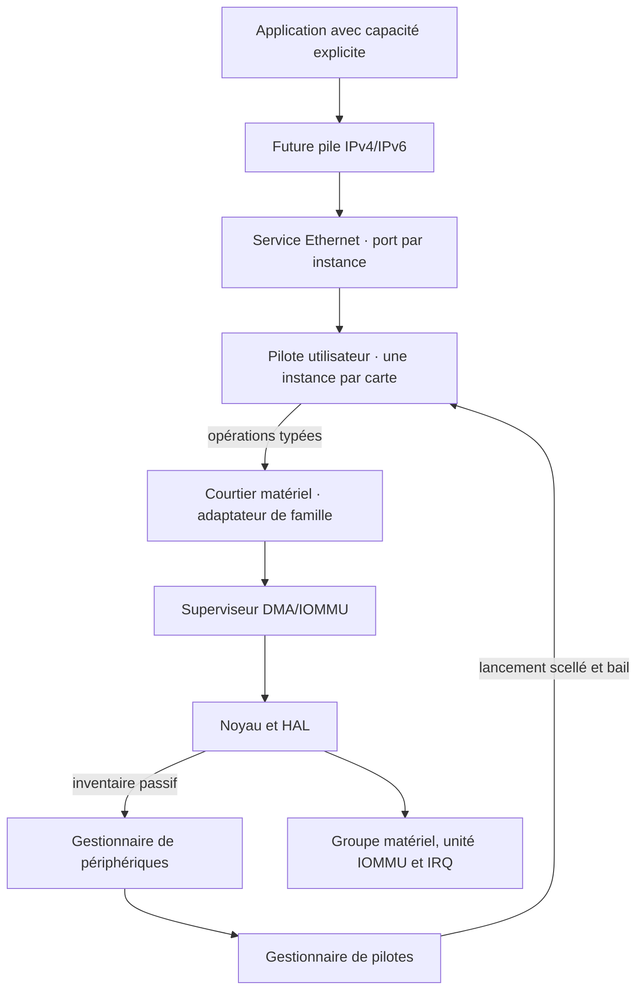
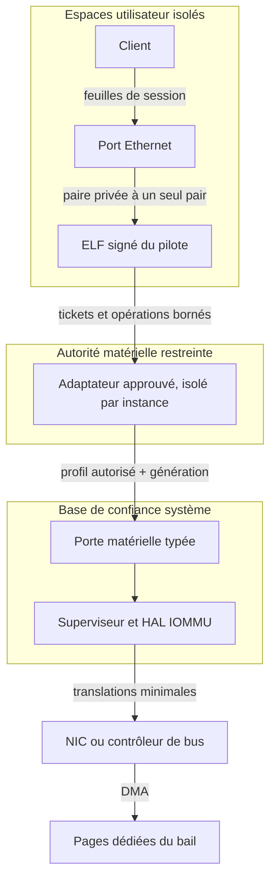

# NovaOS — Architecture Ethernet universelle, phase 1

**Spécification proposée à la MOA/MOE le 26 novembre 2026.** La base de conception est `origin/main` à `5c7f1bfa313a3859ccc0830660438e76d598acb1`. L’unité d’installation est un paquet signé. L’unité d’autorité et de panne est une instance attachée à un groupe isolable. L’unité visible de la pile est un port Ethernet versionné. Un paquet peut couvrir de nombreux identifiants et donner lieu à plusieurs instances indépendantes.

La phase 2 dispose de son [contrat binaire exécutable](contrat-v1-phase2.md), de ses [mesures inter-ISA](mesures-phase2.md) et de sa [décision sur les transports](phase2.md).

## Pièces soumises à décision

| Livrable du mandat | Pièce et décision préparée |
|---|---|
| 1–2. Dossier et diagrammes | Présente pièce. Frontières des neuf acteurs et conditions d’évolution du code privilégié |
| 3. Contrat Ethernet v1 | [Port de trames, droits, tickets et événements](port-et-ipc.md) |
| 4–5. Gestion dynamique et manifeste | [Sélection, installation signée et remplacement](pilotes.md) |
| 6. Comparaison IPC | [Coût des fragments, de la boîte de 4 Kio et des fenêtres privées](port-et-ipc.md#transport-et-coûts) |
| 7. Permissions DMA | [Droits par objet, retrait et quarantaine](dma.md) |
| 8–9. Budgets et montée en charge | [Profils RAM, limites de la base et coûts de 1 à 100 interfaces](capacite.md) |
| 10–11. Matrice et protocole commun | [Niveaux de preuve, oracles et mesures](qualification.md) |
| 12–14. Intégration VirtIO-net, mandats et arbitrages | [Étapes, conditions de passage et réserves](qualification.md#intégration-progressive-de-virtio-net) |

## Composants

| Acteur | Responsabilité | Limite de son autorité |
|---|---|---|
| Noyau et HAL | Espaces Ring 3/EL0, capacités, mémoire, copie, interruptions et primitives de confinement. Attribution et retrait restent possibles après la mort d’un processus | Aucun choix de marque, de pilote préféré ou de protocole IP |
| Gestionnaire de périphériques | Inventaire passif, identifiant d’attachement renouvelé au branchement, bus et topologie, événement de présence avec numéro de révision | Une observation ne confère aucune capacité d’armement |
| Gestionnaire de pilotes | Vérifie le catalogue signé, choisit le candidat, réserve les ressources et orchestre lancement, remplacement et retrait | Demande un bail au superviseur pour une instance précise. Aucun accès aux trames ni aux tables IOMMU |
| Courtier matériel | Contrôle le profil de famille autorisé, les opérations à effets de bord, les formats de descripteur, les files, les IRQ et la fermeture autonome | Vérifie ordres et complétions contre un état de confiance. Aucun accès PCI/MMIO libre depuis l’ELF pilote |
| Superviseur DMA/IOMMU | Propriétaire des cadres, groupes, domaines, traductions, barrières, reçus et quarantaines. Sérialise les changements pour chaque unité | Accorde chaque usage selon la plateforme et la politique. Une remise de crédit Ethernet ne libère aucune page DMA |
| Pilote réseau isolé | Machine d’état propre au matériel, gestion du lien, demandes de préparation de files et progression. Un espace d’adressage et un bail par instance | Échange slots et opérations typées. Une faute du pilote déclenche le retrait par le superviseur |
| Service Ethernet | Termine le contrat L2, filtre selon les droits de session, arbitre crédits et équité, tient les tickets et présente un port uniforme | Traite les entrées du pilote comme non fiables. Une défaillance du pilote peut affecter le trafic de **sa** carte. La livraison au pair exige un oracle indépendant |
| Future pile native | Choix de l’interface, routage futur, adhésions multicast L2, soumission et récupération des trames | Ne voit ni bus, ni descripteur, ni vecteur, ni adresse de périphérique. IPv4/IPv6 et transports relèvent d’un mandat ultérieur |
| Applications | Reçoivent uniquement la capacité accordée par la politique du lanceur. Le client courant accéderait au service de la pile | Aucun droit réseau à la naissance. Trames brutes, observation et administration demandent des délégations distinctes |

## Frontières de confiance

Le profil initial confie au superviseur la validation finale des ressources et la publication qui rend un descripteur visible. L’adaptateur de famille peut préparer une représentation CPU contrôlée. La porte valide les ressources référencées, fige l’image matérielle et arbitre ses mutations. Une opération dont les pointeurs, les effets de bord, les transitions ou le drainage ne sont pas vérifiables avec le profil installé est refusée. Les règles de médiation et de fermeture font partie de la base de confiance, y compris lorsqu’elles s’exécutent dans un processus isolé.

**Évolution privilégiée proposée.** Un nouvel ID pris en charge par une famille approuvée demande un paquet et sa qualification. Une nouvelle famille exprimable utilise un profil de médiation séparément signé par l’autorité système, versionné, limité en ressources et évalué avant installation. Le vocabulaire proposé porte sur des actions typées bornées, des masques, des champs de descripteur et des transitions de retrait finies. Pas de scripts arbitraires en mode noyau. Le superviseur conserve le dernier profil approuvé et le chemin d’arrêt, même après la disparition de l’adaptateur. Le prouveur de profils, les règles admissibles et le coût maximal par action restent à spécifier et qualifier. Un nouveau mécanisme privilégié, un droit supplémentaire ou un nouveau backend HAL impose un mandat système, une construction éventuelle du noyau et la requalification des profils concernés. Un signataire de pilotes ne peut étendre ce vocabulaire. Une révision privilégiée entre dans un dépôt de profils distinct après revue du graphe d’états, des accès autorisés et de la borne d’exécution. Épingler la révision au bail jusqu’à la fin de son retrait. Avant migration, tester les anciennes et nouvelles versions en espace isolé, y compris fermeture après mort de l’ELF. En cas de défaut, bloquer les nouvelles ouvertures et garder l’ancienne séquence de retrait pour les baux qu’elle possède.

## Point de départ vérifié

| Statut au SHA examiné | Ce que l’architecture en reprend | Travail requis |
|---|---|---|
| Présent dans la base | 48 sélecteurs, IPC DATA de 128 octets, dérivation/révocation, quatre racines par créateur. `IPC_PUT/TAKE/FEATURES` sur une paire liée, région superviseur de 4 Kio | Authentifier les deux extrémités pour Ethernet, compter les ressources de tous les acteurs et valider le nouveau transport privé. [Registre](../../abi/syscalls.toml) · [IPC](../ipc-abi.md) · [Boîte de transfert](../../kernel/src/sched/process/ipc/bulk.rs) |
| Présent dans des profils identifiés de la base | Inventaire PCI, contrat préparatoire DMA physique, validation ELF, précédent du lancement d’un ELF scellé et de tickets récupérables | Catalogue matériel, politique de signature des pilotes et nouvelle autorité de lancement à concevoir. Le précédent signé CUT concerne les profils publiés de qualification. [Inventaire](../../kernel/src/hardware/pci_inventory.rs) · [Chargeur](../../kernel/src/memory/user/elf.rs) · [Qualification du courtier de session](../lancement-generique-courtier-qemu.md) |
| Présent uniquement sur la branche VirtIO-net étudiée | Échanges Ethernet réels dans les deux invités, domaine du NIC séparé du disque, drainage, retrait concurrent, preuves de panne. Port privé et contraintes du laboratoire | Adapter le port, le courtier et l’ELF derrière des profils explicites. [Audit au commit demandé](https://github.com/NaviStorm/NovaOS/blob/56db7d5c0d04490cd284b91567cbbd4736534266/novaOS/docs/virtio-net-audit-cloture-20261126.md) |
| Proposé pour les matériels physiques | Études Killer E2400 et Intel I219-V de phase 0. Les deux modèles imposent des permissions d’anneau différentes | Attribution physique, IRQ, propriété firmware, trafic et retrait à prouver séparément. Le dossier Lenovo reste local. [Étude publiée E2400](https://github.com/NaviStorm/NovaOS/blob/00335af793e456b6fa6546514f65305f9c114165/novaOS/docs/killer-e2400-architecture.md) |
| À développer | Service Ethernet public à capacités, installation dynamique, médiation évolutive, adaptateurs de bus, profils mémoire et suite de conformité | Le présent dossier définit leurs conditions d’admission. La MOA/MOE décide séparément de chaque implémentation |
