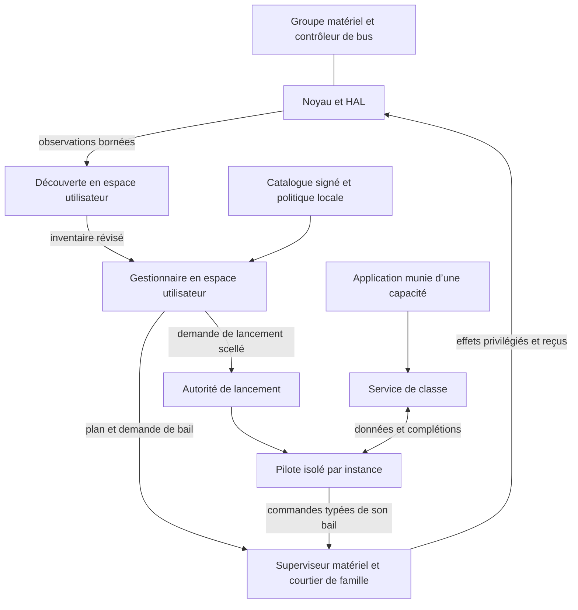

# NovaOS v0.25.0 — Architecture du gestionnaire universel de pilotes, phase 4A

**Statut du 27 novembre 2026.** Proposition de conception. Le gestionnaire décide *quel pilote peut être présenté* pour un groupe matériel. Le superviseur décide *si et quand ce groupe peut changer de propriétaire*. Un service de classe décide *ce qu’une application peut faire* avec le périphérique. La sélection d’un paquet signé ne suffit donc jamais à démarrer du DMA.

| Question de conception | Contrat |
|---|---|
| Qui observe la machine, choisit le pilote et peut agir sur le matériel ? | Responsabilités et sélection ci-dessous |
| Quels octets et quelles autorités lient une révision au matériel ? | [Paquet signé, installation et rollback](paquets.md) |
| Qui peut franchir chaque transition, avec quelles preuves ? | [Machine à états, reçus, IPC et capacités](cycle-et-ipc.md) |
| Quels moyens réserver et quand refuser une admission ? | [Budgets mémoire, IPC et temps](budgets.md) |
| Quels profils reprendre, quels essais demander et quelles décisions restent ouvertes ? | [Intégration, risques, matrice et arbitrages](qualification.md) |

La référence 3D est `4c3bd8896c496636118a7f4751b6947fba72d1e3`. La livraison 3E est `ff9b0322d9f449058a2b575b3d7b7fe868b0d7ad`, son noyau qualifié `fd3ff113fcaf39bee804eebdcedc44557f41817d`. Ces résultats concernent des invités et des topologies identifiés. La garde de réadmission Q35 demeure une condition impérative. Le jalon documentaire v0.25.0, la version interne v0.20.0 et l’ABI native v1 sont trois identités distinctes. [Rapport 3D](../architecture-ethernet/phase3d.md) · [Rapport 3E](../architecture-ethernet/phase3e.md) · [Contrats hérités](../architecture-ethernet/contrats-phase3e.md)

Le catalogue expérimental hors ligne de phase 4B vérifie les signatures et construit un plan de sélection. [Schéma, résultats et limites mémoire](../../libs/catalogue-pilotes/README.md)

Le premier lancement dynamique d’un pilote VirtIO-net a été exercé sous NovaOS AArch64, dans le profil QEMU mono-groupe autorisé par A4. [Lancement, consommation réelle et qualification 4D](phase4d-v0.25.0.md)

## Frontières d’autorité

| Responsable | Action et preuve dont il répond | Autorité détenue |
|---|---|---|
| Noyau et HAL | Installe les espaces Ring 3/EL0, vérifie les droits locaux, protège et épingle les pages, applique les traductions et routes IRQ, ferme/réveille les canaux. Le chargeur valide l’ISA et les segments de sa copie scellée | Tables CPU et IOMMU, allocation des cadres, configuration à effets de bord. Le choix de l’éditeur ou du service appartient à l’espace utilisateur |
| Découverte | Construit un inventaire révisé à partir de sources autorisées, signale apparition, disparition et perte d’événements. Conserve la provenance et précise si une vue est complète | Lecture médiée limitée au bus ou à l’interface du contrôleur parent. Les lectures elles-mêmes doivent être admises par le profil |
| Superviseur et courtier | Un propriétaire par unité IOMMU, un bail exclusif par groupe. Valide les rôles mémoire et le profil de famille, arbitre le reset partagé et les retraits concurrents, détient le journal de preuve. Peut arrêter une source après la mort du pilote | Les décisions de politique et les propositions de descripteurs peuvent vivre en utilisateur. Les opérations irréversibles de publication, d’invalidation, d’arrêt, de masquage IRQ et de restitution restent vérifiées et exécutées par la partie de confiance. Le laboratoire place cette partie dans le noyau |
| Gestionnaire universel | Résout l’index et les dépendances, propose le plan de ressources, orchestre l’instance et publie sa disponibilité quand le service confirme son contrat. Au redémarrage, consulte les propriétaires des baux | Feuilles de contrôle par pair et capacité d’admission restreinte. Aucune BAR, page DMA, clé privée ni donnée d’application |
| Autorité d’installation et lanceur | Vérifie les deux signatures, la politique locale et les octets immuables à charger. Lie les feuilles à une incarnation. Peut retirer les droits de lancement futurs | Lecture d’objets scellés, édition de la tête du catalogue par une autorité distincte, création de l’enfant par le chargeur. Une demande administrative identifie précisément la mutation autorisée |
| Pilote | Un processus isolé par instance. Initialise et fait progresser sa famille, soumet des opérations sur des objets opaques, reçoit des achèvements bornés | Seulement les feuilles et quotas du bail. Le courtier conserve les anneaux publiés et le chemin d’arrêt. Aucun accès libre au bus ou aux cadres du client |
| Service spécialisé | Expose le contrat de classe, arbitre sessions, crédits et droits métier. La chaîne stockage demeure NovaFS → bloc → pilote | Capacité sur son backend actif. Le plan de contrôle universel reste hors du chemin de chaque trame, bloc ou événement |
| Application | Ouvre une session auprès du service par délégation explicite | Lire des entrées, capter du son, émettre sur le réseau, écrire sur disque ou administrer sont des pouvoirs distincts. Le PID et le nom du service ne valent pas délégation |

Le port Ethernet v1 conserve ses huit crédits et ses filtres, ses tickets, les lots PUT/TAKE et le repli DATA négocié à l’ouverture. Un service Wi‑Fi pourrait proposer, séparément, trafic, association radio et administration. Le bloc désigne un namespace et distingue READ, WRITE et FLUSH, que le backend soit NVMe, SATA ou VirtIO. Une interface USB composite peut servir plusieurs classes via un contrôleur unique. La capture audio, le rendu GPU et l’entrée HID ont chacun leurs propres droits et limites temporelles. Une classe future enregistre une interface versionnée auprès de son service. Elle partage la machine de gestion sans introduire ses commandes métier dans le noyau ou le gestionnaire. L’ensemble emploie des handles et messages NovaOS natifs, sans dépendance POSIX. [Contrat Ethernet v1](../architecture-ethernet/contrat-v1-phase2.md) · [Service bloc](../stockage-bloc-v0.10.0.md)

### Exemple de périphérique composite

Un clavier USB avec interface audio fournit deux objets de service au cours d’un même attachement. La découverte rattache les interfaces à la configuration courante. Le service d’entrée peut recevoir les événements du clavier et le service audio demander des transferts périodiques. Les applications obtiennent séparément saisie, lecture audio et capture du microphone. Le contrôleur USB garde l’unique autorité sur ses files DMA. Si la fermeture de l’interface audio requiert un reset du périphérique entier, le superviseur refuse le reset isolé tant que le clavier reste attribué. La disparition du câble clôt les deux objets et déclenche une seule réconciliation côté contrôleur.

| Autre classe | Ce que le contrat de classe doit borner | Ce que vérifie le superviseur |
|---|---|---|
| Wi‑Fi | Émission de données, association et observation radio par délégations distinctes | Firmware admis, files et portée d’un arrêt de la radio |
| Stockage SATA | Plages accessibles, écriture, FLUSH et statut par requête | Propriété du contrôleur hôte, commandes de chaque port et portée commune d’un reset |
| GPU | Contexte de rendu, objets mémoire et files de commandes par client | Profil capable de valider les références et la portée d’un reset. Un moteur dont les commandes ou le drainage ne sont pas vérifiables reste sans bail |

## Du bus à une instance

1. **Observer.** La HAL fournit des plages de bus autorisées, les descriptions firmware et une lecture bornée. PCI/PCIe recense segment, BDF, fonctions sœurs, ponts et fenêtres, IDs, révision et sous-système avec indicateurs de validité. Une étendue de BAR doit avoir une provenance. L’inventaire normal ne redimensionne pas une BAR active. Un arbre incomplet ou qui change pendant la lecture reste impropre à l’attribution. Le lecteur PCI actuel impose déjà un budget de lectures. [Inventaire du noyau](../../kernel/src/hardware/pci_inventory.rs)
2. **Décrire les autres bus.** En USB, le propriétaire du contrôleur énumère ports, hubs, configurations, interfaces et associations, borne longueurs et profondeur, puis fournit des instantanés. La classe peut être portée par l’interface. Un endpoint USB reste rattaché à la configuration du parent. Le courtier du contrôleur est le seul à publier son DMA hôte. Un changement de configuration invalide les interfaces affectées. Pour un bus de plateforme, l’adaptateur associe un nœud ACPI ou DT, son parent, les flux DMA, IRQ et dépendances d’alimentation. Les identités synthétiques d’un bus virtuel exigent un fournisseur authentifié. [Codes de classe USB-IF](https://www.usb.org/defined-class-codes) · [Découverte NovaOS](../../kernel/src/hardware/discovery.rs)
3. **Déterminer la propriété.** Calculer la fermeture des alias DMA, des routes pair-à-pair, des fonctions liées, des domaines de reset/IRQ et des dépendances contrôleur-enfant. Conserver séparément le plus petit groupe isolable et la portée de chaque opération partagée. Si une opération atteint un pair actif, la refuser ou exiger une opération coordonnée explicitement autorisée couvrant tous les propriétaires. Une fonction multifonction, un port USB et un namespace ne constituent pas à eux seuls un domaine DMA. Quand seul le parent est isolable, le parent garde le bail et offre des objets médiés aux enfants. Une topologie non prouvée demeure inventoriée, sans attribution. [Analyse PCI de NovaOS](../materiel-phase4-pci.md) · [Granularité d’isolation documentée par Linux](https://docs.kernel.org/driver-api/vfio.html#groups-devices-and-iommus)
4. **Sélectionner.** Capturer les révisions de l’inventaire, du catalogue et de la politique. Éliminer d’abord signature/révocation, versions OS et ABI, ISA, profil de retrait, dépendances, droits et géométries incompatibles. Parmi les candidats restants, appliquer dans l’ordre l’épingle administrative par empreinte, la priorité de politique puis la précision du match (identité et variante exactes, identité exacte, classe explicitement autorisée). À rang égal, la version la plus élevée départage les révisions d’un même ID et éditeur. Deux éditeurs ou IDs encore au premier rang donnent `CONFLIT`, y compris si l’ordre des événements est inversé. Une épingle devenue inéligible bloque la sélection. Zéro candidat donne `NON_PRIS_EN_CHARGE`. Aucun paquet n’est téléchargé au branchement.
5. **Ordonner et revalider.** Résoudre les dépendances du paquet et du matériel en graphe orienté. Exiger le parent, le contrôleur, la médiation et le service requis avant l’enfant. Détecter cycles et absences, borner visites et profondeur. Verrouiller le groupe avec un ordre stable entre groupes lorsque l’opération en requiert plusieurs. Comparer de nouveau les révisions avant réservation et avant publication. En cas de remplacement au même BDF/port, créer une nouvelle identité d’attachement. Lors d’un retrait surprise, fermer les admissions au premier constat et utiliser la procédure de réconciliation du profil. Une notification perdue déclenche une relecture par révision.

Le coût d’une nouvelle référence compatible porte sur les métadonnées et ses preuves de qualification. Une famille qui exige des effets matériels inconnus reçoit un nouveau profil, avec revue de son confinement et de son retrait autonome. Une nouvelle primitive, une extension de droits ou une nouvelle politique sur un contrôleur partagé demande un arbitrage distinct.
