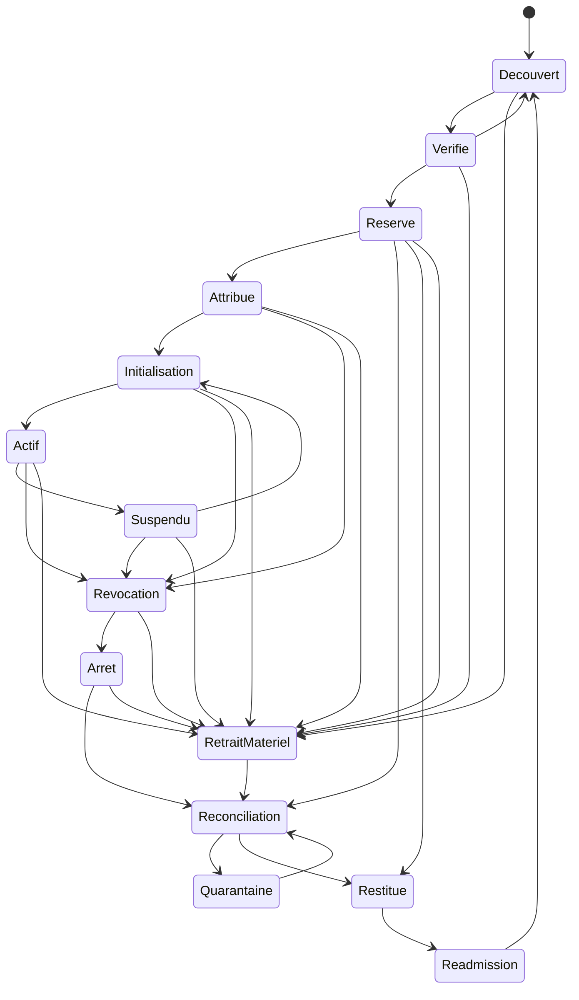
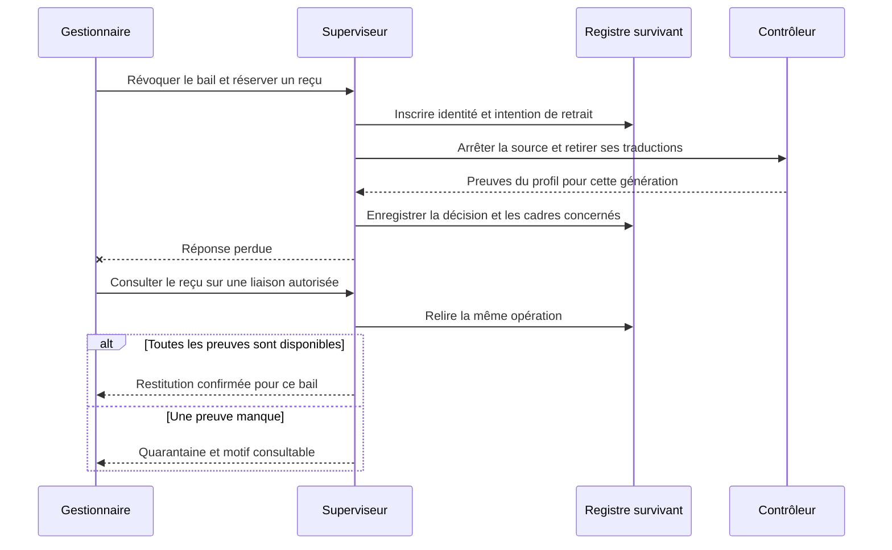

# Cycle de vie, reçus et contrôle IPC

## Identités et propriété

Le registre conserve trois identités distinctes. L’**attachement** désigne le démarrage, l’unité de contrôle, le groupe isolable, sa révision topologique et son apparition. Le **bail** y ajoute le titulaire, son incarnation, la génération matérielle monotone, le domaine et le profil approuvé. La **liaison IPC** ajoute sa propre époque et ses deux extrémités authentifiées. Un numéro de PID, un BDF, une adresse USB ou un numéro de domaine réutilisé ne permet jamais de reconstruire ces identités. La génération est allouée avant l’attribution et ne boucle pas. Le Q35 a déjà exercé une époque IPC 3 avec une génération matérielle 1. [Contrats d’identité et preuves 3E](../architecture-ethernet/phase3e.md)

L’état ci-dessous est celui **d’un groupe et de son bail éventuel**. Les paquets et les tickets client ont des machines distinctes. Un seul superviseur fait autorité sur chaque contrôleur. Il compare état, génération et opération sous sérialisation avant tout effet. Le gestionnaire conserve des intentions et des observations. Le tableau définit toutes les transitions autorisées. Une transition absente est refusée avant effet. Une consultation ou la répétition exacte d’une opération rend son reçu sans transition.

| Source → destination | Garde, autorité et effet observable |
|---|---|
| Entrée → Découvert | La découverte publie un attachement observé, daté par révision. Les entrées inconnues, ambiguës ou sans candidat restent ici avec un motif |
| Découvert → Vérifié | Le gestionnaire fixe le plan signé, les dépendances, le groupe prouvé et les quotas. Le superviseur confirme l’éligibilité de sa topologie, sans délégation |
| Vérifié → Découvert | Une modification du plan, de politique ou d’inventaire invalide l’instruction. Le gestionnaire relance la sélection sur une vue complète |
| Vérifié → Réservé | Le superviseur sérialise la réservation exclusive sur la révision attendue. Le lanceur réserve CPU, IPC et mémoire de clôture. En cas d’échec, défaire les seules réservations identifiées avant l’accusé |
| Réservé → Attribué | Le lanceur crée une incarnation à partir de la copie scellée. Le superviseur inscrit le bail et toute ressource avant sa première exposition. La délégation de contrôle limitée est rendue visible après cette inscription |
| Réservé → Réconciliation | Le superviseur constate une publication possible dont la confirmation manque. Il conserve les ressources réservées, ferme les soumissions et examine le journal avant de classer chaque cadre. |
| Réservé → Restitué | Annulation certaine avant toute exposition, aucune commande en attente, réservation logicielle intégralement défaite et reçue. Une réservation dont l’exposition est ambiguë suit la réconciliation de retrait |
| Attribué → Initialisation | Le pilote présente la version du contrat via sa feuille. Le courtier prépare seulement les opérations prévues, vérifie domaines, permissions et routes |
| Initialisation → Actif | Le superviseur possède les accusés du profil et autorise les soumissions. Le service confirme l’ouverture du backend. La publication de la nouvelle génération de service rend ensuite les sessions possibles. Une réponse perdue se consulte |
| Actif → Suspendu | Le service ferme la soumission, le superviseur établit la quiescence prévue et classe les opérations en vol. Aucune page n’est rendue. Si le profil ne peut suspendre avec preuve, appliquer la révocation |
| Suspendu → Initialisation | Même titulaire et incarnation, bail exclusif, topologie et contenu du contrôleur revalidés. Le service renégocie ses feuilles périmées avant visibilité. Un changement d’identité impose un retrait complet |
| Attribué, Initialisation, Actif ou Suspendu → Révocation | Arrêt demandé, décès du pilote, échec de préparation ou révocation d’autorité. Le superviseur et le service invalident les feuilles de soumission et les descendants, réveillent les attentes, classent les tickets. Le chemin d’arrêt est déjà sous autorité survivante |
| Révocation → Arrêt | Le courtier tente l’arrêt de la source et la synchronisation IRQ selon la portée de reset autorisée. À partir de l’intention enregistrée, une réponse perdue suffit pour passer à l’examen des preuves |
| Arrêt → Réconciliation | L’autorité propriétaire réunit reçus de quiescence, de retrait des traductions et d’invalidation, registre des cadres et statut des opérations. Toute absence devient un état explicite |
| Découvert, Vérifié, Réservé, Attribué, Initialisation, Actif, Suspendu, Révocation ou Arrêt → Retrait matériel | Débranchement constaté par l’autorité de bus. Clôturer le point d’entrée et propager la disparition aux enfants. Si la carte ne répond plus, employer les seules preuves admissibles du parent et du contrôleur |
| Retrait matériel → Réconciliation | Le superviseur inventorie ce qui a effectivement été exposé. Une disparition avant attribution permet une réconciliation vide si l’inventaire est complet |
| Réconciliation → Quarantaine | Une preuve indispensable manque, est obsolète ou concerne un autre groupe. Épingler les pages concernées, les tables, le groupe et les reçus. Une panne de l’unité gèle tous les groupes dépendants avant toute tentative locale |
| Quarantaine → Réconciliation | Nouvelle preuve authentique, collecte différée ou récupération coordonnée autorisée. Le superviseur relit les états et consomme chaque preuve une seule fois. Le délai seul ne déclenche jamais de restitution |
| Réconciliation → Restitué | Le propriétaire atteste, pour chaque cadre, la fin d’accès de la source, le retrait des traductions requis et le retour de propriété. Une restitution partielle est enregistrée par cadre, le groupe reste en quarantaine tant que l’ensemble requis est incomplet |
| Restitué → Réadmission | Demande pour un attachement présent, ancienne clôture complète, politique courante et dépendances vivantes. La garde du contrôleur est revalidée avant toute réservation. Q35 avec le même bail NVMe actif refuse ici, sans consommer de nouvelle attribution |
| Réadmission → Découvert | La découverte produit une vue fraîche. Le futur bail possède une nouvelle génération et le lanceur devra créer une nouvelle incarnation. Un périphérique absent demeure au registre des restitutions |

Pour une réservation logicielle dont on découvre tardivement une exposition possible, le superviseur conserve le propriétaire inscrit avant la publication. Si l’inscription Attribué a été engagée, on reprend à cet état et on révoque. L’état du contrôleur est orthogonal à celui du groupe. Dans le régime Gelé, toute nouvelle attribution ou soumission est interdite. Si le registre est illisible, l’autorité survivante gèle le contrôleur entier. Elle le rouvre seulement après reconstruction authentifiée de ses baux, réconciliation des opérations engagées et contrôle de l’état matériel. Une demande d’arrêt pendant Réconciliation ou Quarantaine consulte ou complète l’opération initiale. Une disparition dans ces états ajoute une observation sans recréer le bail.

## Conservation des preuves

Une ligne de journal porte `(démarrage, contrôleur, attachement, titulaire, incarnation, génération, type, numéro)`, l’empreinte de la requête, les ressources concernées et l’état `préparé / soumis / confirmé / consommé`. Inscrire l’intention et la liste des cadres avant la publication matérielle. Lire la confirmation à la source prévue par le profil. Quand un changement d’index signale plusieurs complétions, les rattacher individuellement aux opérations attendues. Un reçu de reset, un reçu IOMMU et un ticket Ethernet ont des types distincts. Une preuve tardive peut lever une quarantaine, sans transformer un ticket TX incertain en succès. [Preuves ARM et Q35](../architecture-ethernet/contrats-phase3e.md)

Le noyau ou une autorité de ressources indépendante du PID du gestionnaire et du superviseur doit pouvoir retenir le groupe et les cadres pendant la reprise. Prévoir une intention durable avant exposition pour toute ressource qui doit survivre à une perte de cet état. Au redémarrage, authentifier l’époque, la tête et les ressources encore exposées avant de réactiver l’allocateur concerné. À défaut d’inventaire fiable, confiner le contrôleur et ses zones potentiellement accessibles, ou arrêter l’amorçage avant leur réemploi. Un démarrage à froid ne rétablit la propriété que si la plateforme démontre un nettoyage couvrant la source, les pairs et les caches de traduction. Le banc 3E conservait les reçus en mémoire du superviseur vivant. Le stockage d’un journal sur le seul disque dépendant du contrôleur en panne créerait une dépendance circulaire.

Le gestionnaire redémarré lit la politique puis recoupe catalogue, baux, opérations et publications de service. Un seul titulaire peut reprendre un mandat de contrôle après révocation de l’ancien canal. Tant qu’un pilote, son courtier et le service restent sains, le trafic déjà autorisé peut continuer sur un autre groupe indépendant. La disparition du superviseur bloque les nouvelles publications sous sa responsabilité. Une panne commune de contrôleur peut interdire aussi la poursuite des I/O du disque qui en dépend. Le diagnostic ne promet la continuité que pour les ressources dont les preuves restent valides.

### Une réponse de retrait se perd

La même demande peut survivre au processus qui l’a envoyée. L’exemple suppose le superviseur et son journal encore disponibles. L’autorité de contrôle du gestionnaire de remplacement est renouvelée avant la consultation.

## Contrats de contrôle proposés

Le contrôle utilise DATA de l’IPC native. `ReceiveV1` ne certifie pas le PID d’un émetteur dans la charge utile. Chaque relation emploie une paire privée provisionnée avant publication, avec un seul pair autorisé. Les handles locaux se transfèrent par don IPC atténué au point d’effet du noyau. Un entier dans un message ne représente jamais une capacité. [ABI IPC](../ipc-abi.md) · [Révocation et livraison](../ipc-security.md)

| Relation | Opérations dans la version proposée | Capacité et effet |
|---|---|---|
| Découverte → gestionnaire | `ENUMERER(revision, curseur)`, `CHANGEMENT`, `RELIRE` | Observation bornée et filtrée. Les notifications peuvent fusionner. Une rupture de séquence force une nouvelle énumération |
| Gestionnaire ↔ catalogue | `RESOUDRE`, `LIRE_PLAN` | Lecture du seul plan admis pour la politique du canal. Installer, retirer, révoquer une clé ou autoriser un rollback requiert un mandat administratif distinct |
| Gestionnaire ↔ lanceur | `PREPARER`, `LANCER`, `ANNULER`, `RECU` | Le ticket de lancement privé lie image scellée, plan, sujet et budget. Une seule création d’enfant par clé. Le lanceur installe les feuilles de l’enfant |
| Gestionnaire ↔ superviseur | `RESERVER`, `ATTRIBUER`, `SUSPENDRE`, `REVOQUER`, `RECONCILIER`, `ETAT` | Par groupe admis et par révision. L’autorité dédiée au retrait et à la consultation reste disponible après révocation du pilote. Une demande de restitution n’est qu’une demande d’examen |
| Gestionnaire ↔ service | `PREPARER_PORT`, `PUBLIER`, `FERMER`, `RECU` | Contrôle limité à l’instance désignée. Un handle de service n’autorise ni l’installation ni la délégation matérielle |
| Pilote ↔ courtier et service ↔ pilote | Opérations typées du profil et contrat de classe négocié | Feuilles sans GRANT/MANAGE par défaut, bornées au bail. Le propriétaire garde les racines. Les applications reçoivent des droits de service distincts des commandes du pilote |

**Enveloppe proposée pour le contrôle.** 32 octets little-endian puis 0 à 96 octets de corps. Offsets 0, 2, 4 et 6 pour majeure, opération, longueur totale et drapeaux (u16). Offsets 8, 16 et 24 pour époque du canal, ID de demande et révision attendue (u64). Époque et ID non nuls. La première négociation utilise l’époque provisionnée et retourne la mineure commune. Une lecture initiale peut demander la révision courante avec zéro. Une mutation exige une révision exacte. Le serveur rattache le corps au plan et au groupe scellés côté autorité. Une liste longue se lit par curseur opaque lié à une révision fixe. Aucun pointeur d’appelant. Version inconnue, drapeaux réservés ou longueur incohérente sont refusés avant effet.

Le résultat métier tient dans le corps de réponse avec la même époque et le même ID. `REFUSE`, `CONFLIT`, `PERIME`, `SATURE`, `EN_COURS`, `CONFIRME` et `INCERTAIN` sont des résultats de service. La porte native garde ses propres erreurs. Une mutation réserve sa place de reçu avant le premier effet. Même clé et même contenu renvoient le reçu connu, même clé avec contenu différent donne `CONFLIT`. Après une perte de réponse, `RECU` ou `ETAT` permet de reprendre. Si l’époque précédente est fermée, une nouvelle liaison de gestion explicitement autorisée peut consulter les opérations par leur identité complète dans le journal survivant. Un reçu absent après publication possible donne `INCERTAIN`. L’acquittement d’un reçu confirmé libère sa place selon le plancher de rejeu conservé. Une place manquante pour une nouvelle opération donne `SATURE` avant effet. Les anciennes générations, les numéros épuisés et les droits étrangers sont refusés. Tout nouveau raccord privilégié entre ces acteurs reste à arbitrer. [Registre des 48 sélecteurs](../../abi/syscalls.toml)
