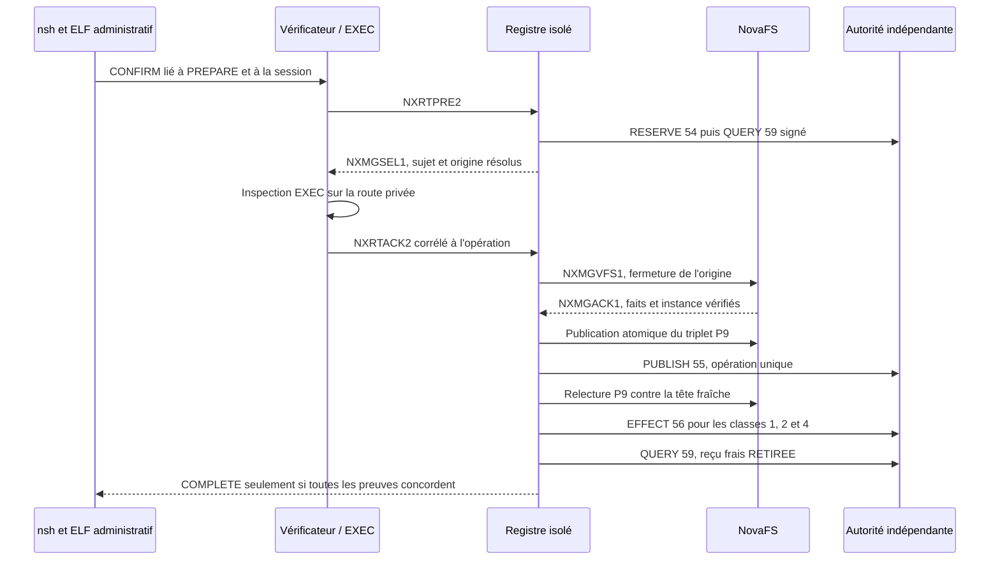

# NovaAuth R2 — Intégration administrative sélective, état intermédiaire

23 novembre 2026. Branche `codex/novaauth-administration-0240-phase1`.
Base publiée `49739dd4b31448e579d308262a1c149a6d887520`, code antérieur
`735605b217837df91321db71cdee58d4ec7581ab`.
Code de cette livraison : `1d5a678a5c8451c01606b102d997e76681eceee2`.
Arbre : `e18173ad333aa467552122cfd4d863006a6f79b2`.

**L'intégration complète demandée reste inachevée.** Le parcours administratif
réel est raccordé aux acquittements privés dans le cas borné sans délégation G
ouverte. Les recettes Q1–Q4 complètes ne sont pas qualifiées. Cette livraison ne
propose ni clôture R2, ni fusion, ni activation ordinaire.

## Parcours réellement raccordé

Les trois exécutions de l'ELF `usermod --remove-group base alice --prepare`, `--confirm` et
`--outcome` s'exécutent depuis le vrai `nsh`, avec contrôle serveur de la session,
de l'instance, de l'installation attestée et de la capacité administrative.
Le registre calcule la révision d'appartenance dans sa vue authentifiée. Aucun
nom fourni par le CLI ne constitue une provenance de capacité.

L'inspection EXEC actuelle démontre uniquement l'indépendance des installations
personnelles (`scope=[0;3]`). Une admission en construction, une provenance
inconnue ou une session cible absente empêche l'acquittement. NovaFS refuse aussi
un inventaire de leases du sujet sans provenance. Une écriture PREPARE annulée
mais non associée à son admission durable conserve **UNCERTAIN** ; aucun FINISH
individuel n'est inventé.

Les effecteurs attendus sont les instances effectivement inscrites par le noyau
QEMU dans la route privée : NovaFS pour la classe 1, vérificateur/inspection EXEC
pour les classes 2 et 4. Ces deux dernières classes ne désignent pas deux
processus distincts. Le masque du reçu ne remplace pas les identités détaillées.

La réservation et chaque ACK sont marqués envoyés avant l'échange. Une réponse
perdue conduit à une consultation authentifiée par identifiant. Un ACK qui ne
figure pas dans l'ordre durable n'est ni inventé, ni renvoyé automatiquement.
Le résultat peut alors rester UNCERTAIN, même si la fermeture locale a eu lieu.

## Corrections et diagnostics conservés

1. **Accès au bloc de démarrage.** Le lecteur historique `runtime::config`
   refuse les indices supérieurs à 19. Les identités privées situées aux mots
   23–26 et 27–30 provoquaient donc une panique, propagée ensuite comme fermeture
   IPC. Un lecteur privé borné à ces deux seules plages corrige les deux appels.
   La borne historique et les droits des anciens clients restent inchangés.
2. **Traçabilité de l'essai 02.** Une substitution de chemin dans le lanceur hôte
   n'avait pas sélectionné la nouvelle ISO. Cet essai a rejoué les trois
   artefacts de l'essai 01. Le relevé original est conservé, avec un correctif
   documentaire distinct. Le lanceur compare maintenant les SHA des artefacts
   à leur relevé de construction avant de démarrer QEMU.
3. **Sondes AArch64 fusionnées.** LLVM a donné la même adresse
   `ffffffff8009e990` à `nova_r2_session_observe` et `nova_r2_output_observe`.
   Le dictionnaire du collecteur écrasait la première entrée : aucune session
   n'était reconnue et le banc attendait ensuite la fermeture de Bob. Le
   collecteur distingue désormais le PC autorisé et les formats canoniques
   de 80/272 octets, puis conserve toutes les vérifications de contenu et de
   liaison. Les binaires invités n'ont pas été modifiés pour cette correction.
4. **Réconciliation redondante.** Lorsqu'un ACK n'était jamais admis, chaque
   requête intermédiaire provoquait une nouvelle consultation du retrait,
   une relecture P9 et des échanges TLS. Le banc atteignait ses 128 connexions
   avant OUTCOME (statut shell 126, aucun résultat administratif). Après
   activation P9 vérifiée, la réconciliation sélective est maintenant demandée
   par OUTCOME de la même opération ; les consultations indépendantes gardent
   leurs propres contrôles de tête fraîche et de capacités. Si la publication
   n'a pas encore été réconciliée et activée, cette étape reste préalable.
   Le témoin corrigé x86_64/512 utilise 79 connexions et retourne UNCERTAIN.

Aucun délai de bail, plafond IPC, timeout de sécurité ou budget du relais n'a été
augmenté. Les échecs, journaux et métriques initiaux restent archivés.

## Qualification et portée des preuves

La matrice machine est dans
[matrice-integration.json](validation/novaauth-r2-integration-selective-v0.24.0/matrice-integration.json).
Elle conserve chaque commande, son PID, ses statuts natif/CLI, le profil, le
commit de construction, l'arbre, les empreintes, les dates du verrou et les
ressources observées. Les résultats des quatre profils sont détaillés dans le
[tableau des essais](validation/novaauth-r2-integration-selective-v0.24.0/resultats-profils.md).

Les sous-parcours nouveaux ont les oracles suivants, tous avec comparaison
exacte de stdout/stderr et vérification de l'ordre durable :

| Sous-parcours, sans délégation G ouverte | CONFIRM | OUTCOME | Autorité attendue |
|---|---|---|---|
| Nominal | OK, CLI 0 | COMPLETE, CLI 0 | RETIREE, trois ACK |
| Réponse perdue après ACK VFS durable | UNCERTAIN 22, CLI 20 | COMPLETE, CLI 0 | RETIREE, aucun second ACK |
| Réponse perdue après publication durable | UNCERTAIN 22, CLI 20 | COMPLETE, CLI 0 | RETIREE, une seule mutation |
| ACK interrompu avant admission | UNCERTAIN 22, CLI 20 | UNCERTAIN 22, CLI 20 | RETRAIT_EN_COURS, aucun ACK inventé |

Les deux cas d'ACK sont différents : une réponse perdue n'établit pas l'absence
ou la présence de la décision. Seule sa consultation durable permet de trancher.
Les admissions applicatives individuelles, les handles G vivants et les
interruptions avec redémarrage ne sont pas exercés par ces sous-parcours.

Au total, la campagne instrumentée contient **28 essais exécutés : 24 réussites
et quatre échecs conservés**. Les douze essais des trois injections sur l’arbre
final réussissent (**0/12 échecs**). Les échecs antérieurs sont détaillés dans
la matrice ; les résultats non exécutés ne sont pas comptés comme réussis.

| Recette du mandat | x86_64/512 | x86_64/4096 | AArch64/512 | AArch64/4096 |
|---|---|---|---|---|
| Q1, handles Direct/H/G réels | Non exécutée | Non exécutée | Non exécutée | Non exécutée |
| Q2, opérations G en vol et réveils | Non exécutée | Non exécutée | Non exécutée | Non exécutée |
| Q3, retraits/admissions concurrents | Non exécutée | Non exécutée | Non exécutée | Non exécutée |
| Q4 complète, pertes et reprise froide | Partielle | Partielle | Partielle | Partielle |

Les essais hôtes/natifs sont distincts : coordinateur réel avec doubles de RPC
et de stockage **12/12** sur Darwin ARM64 et **12/12** sous Rosetta ; vue et plans
administratifs **11/11** ; autorité et époques **32/32** ; collecte **19/19** ;
contrôles du profil **3/3** ; modes du banc **7/7** ; registre ABI **9/9** sur les
sources et **9/9** sur l'export final. Les deux constructions invitées réussissent.
Les tests natifs d'effecteurs/protocole antérieurs restent applicables aux
fichiers inchangés, après contrôle des empreintes. Ils ne sont pas comptés comme
de nouveaux essais QEMU. Les quatre ELF historiques ne sont pas rejoués dans
cette campagne ; aucune nouvelle qualification de ces ELF n'est revendiquée.

## Identité des candidats et applicabilité

- L'instantané de construction final
  `95defcc22404b35ffd9b06dbcbbc33af30538bfe` a exactement l'arbre du commit
  `1d5a678a5c8451c01606b102d997e76681eceee2`.
- Les premiers sous-parcours ont utilisé
  `76eea1961d63e6003278afbe1c833a65ee20018a`. Les chemins d'incertitude affectés
  par la correction de réconciliation sont rejoués sur l'arbre final et leurs
  résultats antérieurs restent conservés, sans substitution.
- Le nominal x86_64/512 initial utilise
  `8140dbc6dfedc4620205ba77ed584f12d224e787`. La différence invitée suivante est
  le marqueur observant le succès de l'inspection EXEC. Les contrôles et le
  résultat de l'inspection sont identiques. La correction finale de
  réconciliation n'intervient que lorsqu'une opération reste en attente après
  publication : le nominal terminé libère cette opération. L'applicabilité du
  nominal est documentaire et n'est pas présentée comme une nouvelle exécution
  de ses anciens binaires sur l'arbre final.

Les patches des instantanés permettent de retrouver les sources exactes des
constructions locales. Les SHA des ISO, noyaux et registres sont archivés ; les
binaires privés de laboratoire ne sont pas ajoutés à Git.

## Ressources et temps

Le coordinateur `Selective` mesure **336 octets**, sous sa borne de 512.
Les deux emplacements réellement réservés mesurent 336 octets (pending) et
352 octets (terminal avec propriétaire). Avec le sous-total hérité de 2 960
octets, le sous-total statique est **3 648 octets**, sous la cible de 4 Kio,
mesuré sur les deux architectures. Ce total ne prétend pas mesurer les copies
temporaires sur pile ni toutes les allocations physiques.
Aucune racine ni capacité publique supplémentaire n'est créée. Les pics de
racines observés, la cinquième demande refusée et la restitution des processus,
handles, endpoints et cadres IPC sont enregistrés par essai. Le drainage final
exige `endpoints=0 nodes=0 espaces=0 cadres_ipc=0`.

Les maxima mémoire extraits des traces sont des **maxima d'échantillons** par
PID, pas un suivi continu de toutes les allocations. Les mesures du registre et
du signataire distinguent pages, pile et cadres IPC globaux. Le bilan conserve
la réserve instrumentée AArch64 de 301 cadres et celle de reproductibilité
binaire entre environnements ; aucune n'est levée ici.

Les durées d'attente du verrou et d'exécution sont des mesures monotones hôtes.
Les durées TLS sont exclusivement des différences d'horodatages monotones
invités ; aucune soustraction entre les deux horloges n'est utilisée. Le
[compte des durées](validation/novaauth-r2-integration-selective-v0.24.0/temps.json)
sépare essais, constructions/contrôles et reliquat de développement/diagnostic.
Les acquisitions et libérations individuelles sont conservées. Aucun verrou
étranger n'a été forcé.

## Travaux restant à implémenter et qualifier

1. **Octrois VFS réels.** `View.permission` et `Directory::membership_grant`
   existent mais ne sont pas reliés dans le parcours invité. Le chemin isolé
   `recuperation_vfs.rs` traite actuellement la lecture directe `NA5READ1` des
   témoins P/L. Le chemin historique `policy_directory.rs` utilise l'autorité
   locale et reste interdit dans cet export. Il faut transmettre la décision
   fraîche et sa provenance au port privé, puis lier le handle au titulaire,
   à la session, à l'objet et à la décision attestée. Aucun octroi ne peut être
   simulé par le CLI pour obtenir une réussite Q1.
2. **Admissions individuelles.** L'identifiant local de requête VFS u64 n'est
   pas encore associé au tuple durable (identifiant 16 octets, origine,
   effecteur, position). Une annulation locale observée ne peut donc pas encore
   produire FINISH. La barrière conserve UNCERTAIN dans ce cas. Raccorder ADMIT,
   l'issue individuelle et sa consultation avant les essais en vol Q2/Q3.
3. **Dépendances EXEC de groupe.** Le raccord présent inspecte les installations
   personnelles. Les tickets effectivement fondés sur G doivent encore porter
   leur provenance et rejoindre le drainage sélectif ; les scopes inconnus sont
   refusés au lieu d'être reclassés personnels.
4. **Reprise froide.** La reprise du même identifiant fonctionne dans l'instance
   vivante. Après redémarrage, la reconstruction du contexte depuis les
   réservations signées, l'inventaire des anciennes instances et l'historique
   du principal reste à raccorder. Le cache terminal en mémoire n'est pas un
   historique persistant. Une incarnation neuve ne peut pas acquitter pour un
   ancien effecteur disparu. La réservation non résolue maintient le refus sûr.
5. **Cycle suivant.** La fermeture VFS conserve son opération ; une autre
   fermeture renvoie WOULD_BLOCK. La remise en disponibilité pour une nouvelle
   opération doit conserver les anciennes barrières et être démontrée à partir
   du terminal durable, sans réactiver l'ancien G.

Ces points sont des travaux d'intégration restant dans le contrat approuvé,
pas une restriction de plateforme. Aucun blocage Daybreak ou refus automatique
n'est rencontré dans cette étape. Aucun changement de garanties n'est proposé.
La prochaine qualification doit commencer par les vrais handles Direct/G/H,
puis les admissions individuelles, avant de revendiquer Q1–Q4 ou la clôture R2.

## Conservation et publication

Les 74 preuves de la livraison précédente sont relues et leurs empreintes
vérifiées sans écart. Les traces brutes nouvelles restent conservées hors TMPDIR.
La publication contient une sélection explicite des journaux, résultats, flux
synthétiques et métadonnées de construction, jamais les clés privées, les images
privées ou les dumps bruts de sessions. Le
[manifeste SHA-256](validation/novaauth-r2-integration-selective-v0.24.0/SHA256SUMS)
et le [relevé d'archive](validation/novaauth-r2-integration-selective-v0.24.0/archive.json)
permettent la vérification des fichiers conservés.

Le noyau ordinaire, les 48 sélecteurs ABI, les sources NovaFS P9 et les composants
CLI n'ont pas changé depuis la base. Les adaptations sont activées seulement
par l'export QEMU explicite `membership_r2`. Aucun tag, aucune fusion, aucun
redémarrage des chantiers d'utilitaires ni activation de production.
