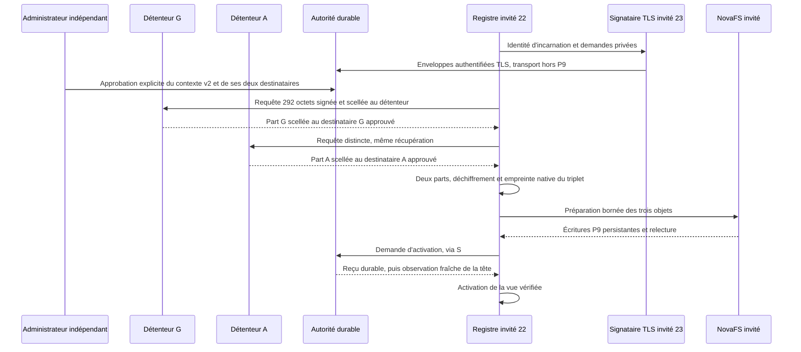

# NovaAuth v0.24.0 — Récupération 2-sur-2 et témoin VFS QEMU

## Périmètre et décision

Raccord expérimental de la branche `codex/novaauth-autorite-0240`, suivant le
[contrat 2-sur-2](novaauth-recuperation-2-sur-2-v0.24.0.md) et
[l'encodage approuvé](novaauth-enveloppes-recuperation-v0.24.0.md).
La référence documentaire complète vérifiée est
`cf3d2182c66965742ee54583bffdf84dc474e1ce` ; la transcription raccourcie
`f3d2182…` du mandat ne désigne pas un autre contrat.

L'autorisation porte sur la qualification QEMU, sans activation ordinaire,
fusion dans main ni tag. Les résultats finaux et leurs empreintes sont regroupés
dans [la matrice de validation](validation/recuperation-2sur2-v0.24.0.json).
Les limites de cette qualification ne valent pas validation de production.

## Échanges réellement exécutés



Les flèches entre R et les détenteurs transportent des enveloppes opaques via S,
TLS et le relais hôte. Elles ne remettent aucun secret au relais, à S ou à NovaFS.
Les deux détenteurs s'exécutent dans deux processus hôtes distincts. L'administrateur
d'approbation est un troisième processus. Le registre invité reconstitue seul le
secret de sauvegarde après validation des deux remises.

Les deux clés publiques de réception sont créées par R, distinctes et engagées
dans le contexte signé de 376 octets. L'enregistrement authentifié des clés des
détenteurs ne vaut pas approbation d'une récupération. Chaque détenteur vérifie
indépendamment l'approbation, la portée, le rôle et l'issue durable de sa remise.
Un contexte approuvé n'est jamais modifié en place pour remplacer un destinataire.

La requête canonique reste de 292 octets, le contexte v2 de 376 octets et le
manifeste de sauvegarde de 418 octets. La trame applicative est bornée à 2 048
octets, dont 16 d'en-tête, et fragmentée en messages IPC de 128 octets.
Les fragments chiffrés de données ne dépassent pas 1 040 octets.
Ces tailles sont indépendantes des 56 octets de métadonnées de liaison.

## Stockage, publication et résultats incertains

NovaFS est l'unique écrivain du volume P9. Le port privé du registre ne permet
ni chemin arbitraire, ni sélection d'un quatrième objet : seulement les trois
objets d'identité, les plages bornées et l'opération courante. Les écritures
préparatoires peuvent être persistantes sans rendre une nouvelle vue active.

La visibilité transactionnelle du triplet exige la vérification des trois
objets, de leur empreinte native commune et de la tête durable indépendante.
Le registre n'active jamais une préparation partielle. Une ancienne ancre P9 ou
un reçu historique ne remplace pas cette autorité.

Dans la recette complète, Alice demande au registre le retrait de son droit P.
R prépare la génération suivante par NovaFS, publie par comparaison à la tête
durable et vérifie le reçu correspondant. Si la réponse de publication manque,
R conserve `UNCERTAIN` et consulte l'issue par son identifiant : il ne renvoie
pas la mutation. Le même principe s'applique à l'enregistrement de la sauvegarde.

La capture chiffrée de la génération révoquée s'effectue dans R. Le dépôt hors
serveur reçoit uniquement les fragments chiffrés et le manifeste. Une capture
partielle ne devient pas une sauvegarde enregistrée. Sa reprise n'est pas une
réémission implicite des écritures : une nouvelle décision explicite est nécessaire
si aucune issue complète ne peut être retrouvée.

Les RPC privés additionnels distinguent publication, consultation d'issue,
dépôt de fragments, enregistrement du manifeste et lecture de son reçu.
Ils ne sont pas des sélecteurs ABI. La méthode privée `request_private` évite
l'ambiguïté de l'ancien nom local `call` avec le scanner des appels système.
Les assertions ABI historiques n'ont pas été modifiées.

## Effecteur VFS et sessions

Alice et Bob possèdent chacun leur facteur de laboratoire dans leur propre ELF.
Ils répondent réellement aux défis du vérificateur invité. Celui-ci consulte le
registre isolé, qui exige une tête indépendante fraîche avant chaque décision.

Pour une lecture, le client émet la requête sur sa feuille VFS privée. Le
vérificateur atteste au VFS l'instance cliente, le titulaire stable, la session,
la séquence, l'OID et le sceau du dossier. NovaFS vérifie le type, la parenté,
l'ACL de lecture et la surprotection des objets réellement sélectionnés.
Les données vont directement au client ; le registre et le signataire ne les lisent pas.

Le témoin lit exactement huit octets, `ALICE-P\n` ou `ALICE-L\n`.
Il exerce le véritable moteur et le chemin bloc invité ; ce n'est ni une nouvelle
commande publique ni un lecteur de fichiers généraliste.

Un retrait de droit de dossier ne signifie pas fermeture générale de session.
Le client de recette ferme explicitement sa session avant une nouvelle
authentification et vérifie le refus de l'ancien identifiant. Après restauration,
une nouvelle incarnation approuvée et de nouvelles sessions sont indispensables.
Aucune approbation ne valide implicitement la génération obsolète.

## Recette complète et résistance aux pannes

Le banc `autorite_qemu/parcours_recuperation.py` conserve les mêmes autorités
indépendantes pendant tous les redémarrages. Deux disques locaux sont réellement
attachés : P9 et l'ancien support local d'autorité. Ce second support n'est jamais
utilisé pour décider de la fraîcheur.

1. Récupération initiale et authentification d'Alice et de Bob. Lecture binaire P
   par Alice, refus de Bob, lecture L par Alice et nouvelle session explicite.
2. Instantané des deux disques avant toute préparation du retrait, invité suspendu
   pendant une consultation. Une inspection indépendante relit ensuite cet état.
3. Retrait invité de P et reçu durable de génération suivante. P refusé, L lisible.
   Capture chiffrée dans R et dépôt hors serveur.
4. Restauration des deux disques, autorité indépendante inchangée. Sans approbation,
   le registre reste en quarantaine et le VFS refuse P avec zéro octet.
5. Deux témoins distincts : ancienne réponse de tête rejouée, puis autorité
   injoignable après établissement TLS. Dans les deux cas, refus effectif du VFS.
6. Approbation administrative explicite d'une seule nouvelle incarnation.
   Récupération avec les deux parts et le triplet de la tête durable.
   Alice est réauthentifiée : L reste lisible, P reste refusé.

L'option `--resilience` perd volontairement les réponses aux deux mutations
durables (retrait et enregistrement de sauvegarde). Les compteurs exigent pour
chacune une seule mutation et une consultation d'issue, sans seconde publication.

Le banc arrête QEMU par QMP après les issues attendues, suspension et vérification
des opérations bloc, avec synchronisation du fichier de l'adaptateur. Ce n'est
pas un arrêt système demandé par `nsh`. Le terminal de cette recette n'est pas
authentifié ; son refus de `exit` est conservé comme résultat négatif, sans
contournement de sa garde. Les coupures d'alimentation physiques restent hors périmètre.

## Budgets et mesures

| Acteur | Racines maximales prévues |
|---|---:|
| Gestionnaire | 4 |
| Vérificateur 17 | 4 |
| Clients Alice/Bob 18/19 | 4 chacun |
| Provisionneur 20 | 4 |
| Registre 22 | 4 |
| Signataire 23 | 4 |
| NovaFS | 4, sans nouvelle racine pour ce raccord |

Les résultats enregistrent les PID réels et les pics observés, ainsi que les
deux sondes de cinquième allocation refusées avec `LIMIT`. L'attribution
initiale des feuilles reste contrôlée par le profil déjà autorisé.

Transport : deux pages de 4 Kio, état natif 48 octets, supplément de liaison
56 octets, réouverture 20 octets, soit 76 octets hors pages. La sérialisation
reste exactement à 56 octets. Les assertions de borne et les tests de saturation
s'exécutent sur Darwin ARM64 et x86_64/Rosetta ; les quatre invités exercent le transport réel.

R dispose d'une arène privée fixe de 64 Kio pour la vue d'identité.
Elle n'accorde aucun syscall d'allocation, n'augmente aucun quota IPC et ne grandit
pas. Une saturation échoue de manière sûre. Les mesures distinguent pages privées,
pile et cadres IPC globaux ; la pile ne doit pas être comptée deux fois.

Le drainage nominal compare exactement les compteurs avant/après. Lors de la
coupure TLS, S termine avec le statut natif 12 et le noyau retire précisément
sa feuille de R : 7 → 6 handles, racines et mémoire inchangées. Cette restitution
est contrôlée séparément, pas assimilée à une fuite ou à un succès nominal.

La réserve historique AArch64 du seuil instrumenté de 2 048 cadres (+301) reste
ouverte. Elle n'est ni effacée par ces mesures locales, ni corrigée par un
relèvement du budget. Les résultats ne démontrent pas une borne universelle de
mémoire ou de délai sous charge arbitraire. Le délai TLS complet reste de 10 s.

## Traçabilité et essais conservés

Les résultats cryptographiques antérieurs non affectés sont conservés : formats,
deux destinataires, refus de clé substituée, incarnation non approuvée, sauvegarde
ou génération différente, part absente/altérée/expirée/rejouée et reçus perdus.
Les tests natifs couvrent aussi la combinaison de parts de générations différentes,
la compromission d'un seul détenteur, la rotation et la révocation des clés,
les conflits et les reprises concurrentes.

Les contrôles QEMU du parcours complet complètent ces preuves ; ils ne transforment
pas un test de bibliothèque ou d'autorité hôte en test d'intégration invité.
La matrice distingue les niveaux et les binaires réellement exécutés.

Neuf anciens résultats VFS ont consigné l'empreinte d'un ancien fichier Cargo
au lieu de l'ELF réellement embarqué. Ils sont conservés avec
`erratum-empreinte-registre.json`, mais exclus de la preuve d'approbation du
binaire courant. Le banc exige désormais que les octets exacts de l'ELF attesté
soient présents dans le noyau extrait de l'ISO.

Les erreurs intermédiaires restent archivées : instantané pris trop tard,
format d'une sonde, délai IPC hors borne, quota de traces, configuration manquante
du banc hôte, arrêt non autorisé du terminal et comptabilité d'une feuille retirée.
Aucun de ces passages n'est requalifié rétroactivement en réussite.

## Résultats finaux du 17 novembre 2026

| Profil invité | Parcours complets | P avant retrait | P après restauration | Après reprise |
|---|---:|---|---|---|
| AArch64/P9-512 | 5/5 | 8 octets exacts, statut 0 | refus natif 5, zéro octet | L : 8 octets, statut 0 ; P : refus |
| AArch64/P9-4096 | 5/5 | 8 octets exacts, statut 0 | refus natif 5, zéro octet | L : 8 octets, statut 0 ; P : refus |
| x86_64/P9-512 | 5/5 | 8 octets exacts, statut 0 | refus natif 5, zéro octet | L : 8 octets, statut 0 ; P : refus |
| x86_64/P9-4096 | 5/5 | 8 octets exacts, statut 0 | refus natif 5, zéro octet | L : 8 octets, statut 0 ; P : refus |

Ces vingt démarrages utilisent les sources invitées de l'arbre
`94db2ca9bd77c6fc58c0b47e013010521d03c545`. Le contrôle final des sources compilées
ne relève ensuite que la suppression d'un espace sur une ligne vide, hors
littéral ; les ajustements ultérieurs concernent le banc hôte et le rapport.

Soixante qualifications intermédiaires restent exploitées séparément : 44 essais
de remises et d'attaques cryptographiques, 4 de publication du triplet, 8
d'activation et 4 de vue du registre. Les primitives cryptographiques de ces
essais restent identiques. L'activation ajoutée ultérieurement a ses propres
tests. Leur source est récupérable par les patches binaires archivés et leurs
références Git ; aucun ancien résultat VFS affecté par l'erratum n'est compté ici.

Les tests finaux exécutent 40 cas natifs par architecture Darwin (80 exécutions,
ARM64 native et x86_64 sous Rosetta), 46 cas de protocole hôte et les 9 contrôles
ABI. Les quatre ELF historiques conservent leurs résultats et leurs artefacts.
Le registre ABI garde ses 48 sélecteurs et le format disque reste NovaFS P9.

Les noyaux ordinaires de la base documentaire et du candidat, reconstruits au
même emplacement avec les mêmes options, sont **identiques octet par octet**
sur les deux architectures. Une première comparaison à chemins de construction
différents avait des différences d'ordre dans `.rodata` ; ce résultat est archivé,
avec la comparaison contrôlée qui lève cette ambiguïté.

Les compteurs de pages privées du registre/signataire sont respectivement
118/54 sur AArch64 et 124/61 sur x86_64 ; les compteurs de pile valent 64 pages
par acteur et sont rapportés séparément. Les racines restent à quatre maximum.
Les cinq durées hôtes par parcours sont consignées dans la matrice : elles
incluent les services de laboratoire et l'instrumentation, sans constituer un
benchmark du noyau ni une garantie de temps réel.

L'[archive publiée](validation/recuperation-2sur2-v0.24.0.tar.gz) contient
**1 800 fichiers de preuve**, plus son manifeste. Tous les membres ont été
décompressés et comparés à l'original. Son SHA-256 est :

```text
f40955700607eeec24eb9fc20bd71118d776c8a1d22c53e7140b360a0fdc5e2a
```

Le [manifeste par fichier](validation/recuperation-2sur2-v0.24.0.manifest.sha256)
permet de vérifier les journaux, états synthétiques, résultats et sources
intermédiaires. Les binaires exacts sensibles sont copiés durablement hors du
worktree, sous `OS-worktrees/artefacts-prives-recuperation-v2/`, avec comparaison
SHA-256 de l'original et de la copie. Les secrets des détenteurs restent également
hors du worktree et hors de l'archive publique. La recherche des représentations
des secrets de laboratoire connus n'a trouvé aucune exposition dans les preuves
publiables ; elle ne prétend pas détecter universellement tout secret inconnu.

Pour reproduire, appliquer les variables `NOVAOS_TMPDIR`/`TMPDIR` d'AGENTS.md.
Les scripts de construction, qualification et comparaison à chemin constant se
trouvent dans l'archive. Ils demandent les clés privées conservées séparément et
des copies jetables des images ; ne pas les utiliser sur un volume personnel.

## Limites et suites indépendantes

- Qualification sous QEMU TCG, deux vCPU et 256 Mio, AArch64/x86_64 avec P9/512
  et P9/4096. Ni UTM ni matériel physique qualifiés ici.
- L'autorité durable et les deux détenteurs restent hors du périmètre de
  restauration. Restaurer aussi cette infrastructure n'est pas couvert.
- Les processus hôtes séparés sont un laboratoire sous un même compte macOS,
  pas une protection contre un administrateur hôte compromis.
- L'approbation de l'empreinte ELF est assurée par le banc de confiance ; aucune
  attestation matérielle de l'invité n'est revendiquée.
- L'enrôlement initial et l'attribution P/L utilisent des fixtures synthétiques.
  La lecture, la révocation, la capture, la récupération et le refus VFS sont invités.
- Les buffers sensibles utilisent l'effacement explicite/Zeroizing. L'effacement
  physique complet des registres CPU, caches, copies de compilateur et mémoire
  après compromission n'est pas démontré.
- L'arène de 64 Kio et les fixtures de deux comptes ne qualifient pas une charge
  de production de taille arbitraire.
- Le service natif de sauvegarde/restauration, le gardien de production, ses
  procédures de sauvegarde et la protection matérielle des clés restent à réaliser.
- Le transport matériel devra être indépendant de NovaFS et du chemin bloc.
  Cette expérience ne clôt ni NovaAuth ni NovaOS v0.24.0.

Les ISO de laboratoire contiennent des facteurs de test. Les artefacts exacts et
les clés sont conservés dans des archives privées distinctes ; ils ne sont pas
publiés dans Git. L'archive de preuves publiable est vérifiée contre ces secrets
avant publication et référence séparément les empreintes des artefacts privés.
